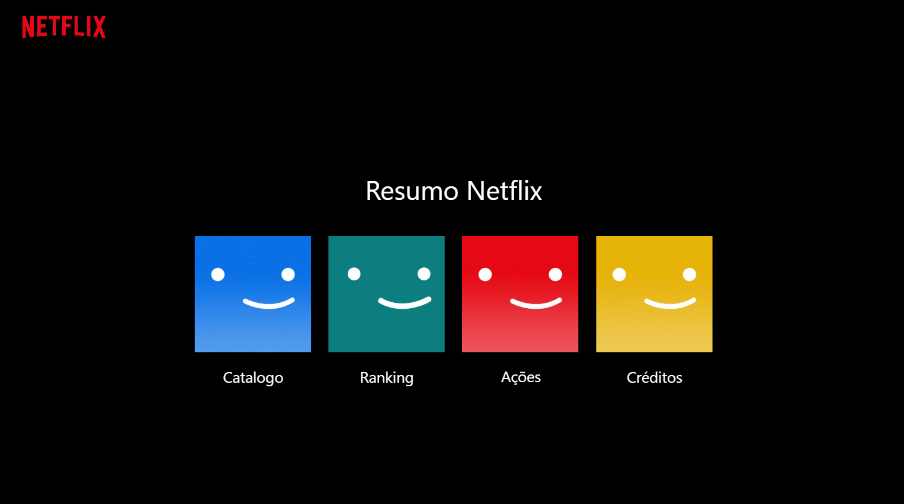
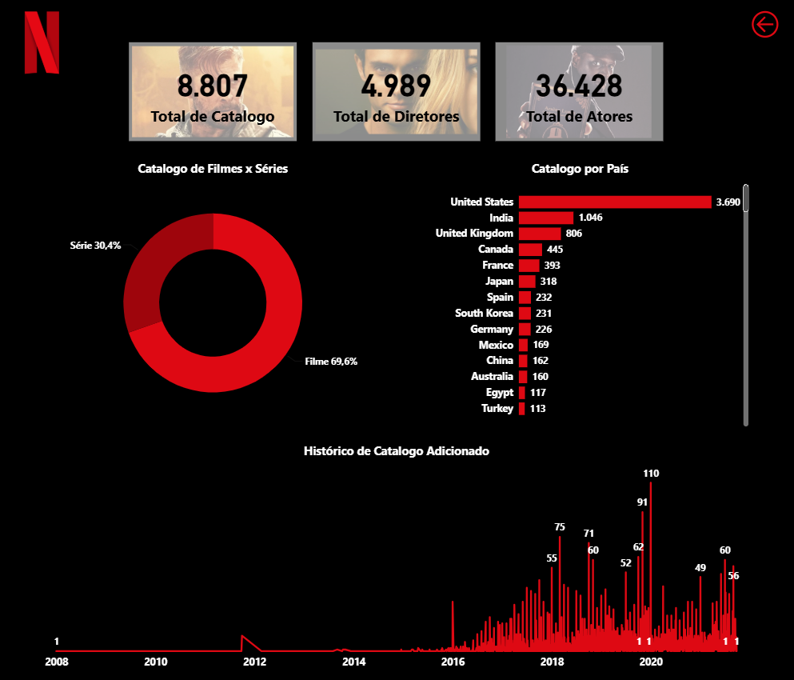
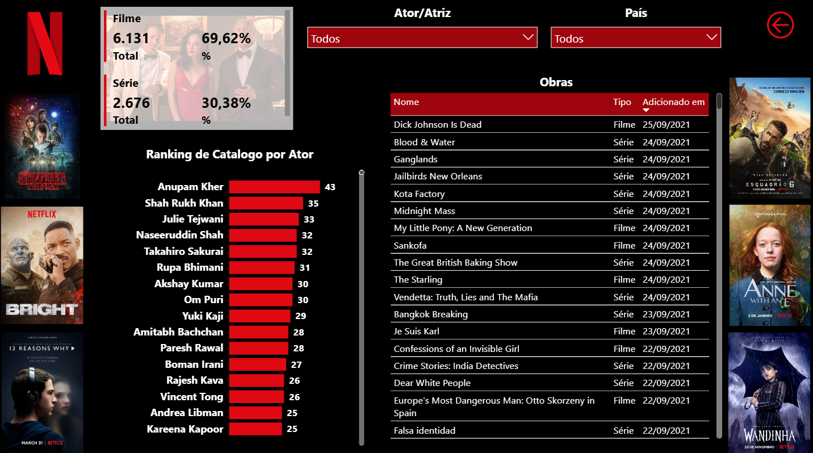
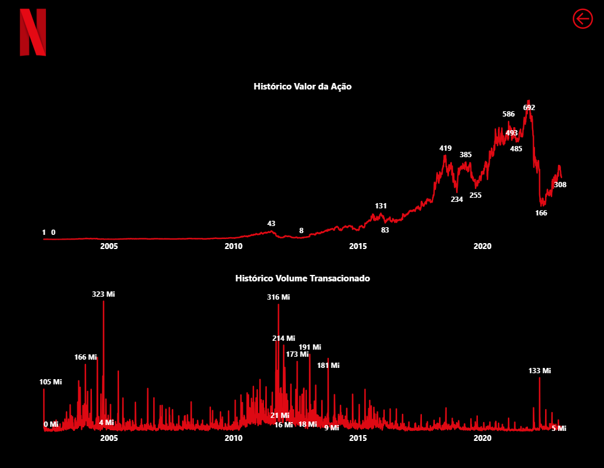
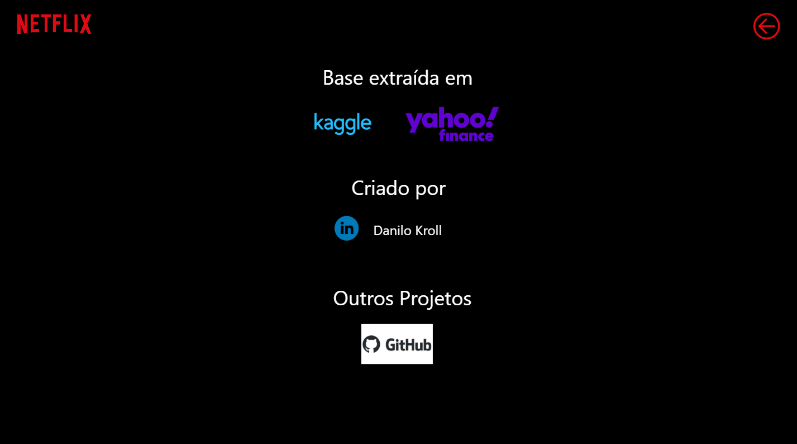

# Exemplo — Netflix

Este exemplo mostra como o SemanticDoc AI transforma um relatório Power BI em um manual para usuários de negócio. O relatório utilizado reúne informações sobre o catálogo Netflix, seus integrantes de elenco e o histórico de negociação da ação.

## Relatório Power BI utilizado

[Abrir o painel Power BI](https://app.powerbi.com/view?r=eyJrIjoiNWYyZTBmYzYtNmQxYi00M2YwLTg3NjItNzQ1NGZiYWQ3MWIzIiwidCI6ImM1MWE2OGQ1LTgwNGItNGZhYi05YTJjLTBiNmI2ODU2NmJhOCJ9)

Os arquivos originais do projeto Power BI não fazem parte desta referência. As capturas e o HTML nesta pasta permitem conhecer a entrada visual e o resultado da documentação.

**Menu**

**Catalogo**

**Raking**

**Ações**

**Créditos**

## Resultado gerado em HTML

[Consultar o arquivo documentacao.html deste exemplo](documentacao.html)

No GitHub, o link abre a página do arquivo. Para visualizar o manual com seu layout e suas abas, baixe `documentacao.html` e abra-o no navegador. As imagens estão incorporadas em Base64, permitindo a consulta offline sem baixar a pasta `img/`.

[Voltar ao README principal](../README.md)
